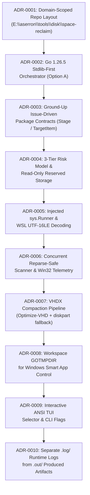

# Architecture Decision Records (ADRs)

This directory contains the chronological **Architecture Decision Records (ADRs)** for **`space-reclaim`**, documenting the engineering decisions in the exact order they were defined during the system's design and implementation.

---

## Chronological Decision Log

| ADR | Title | Status | Defined In | Summary |
| :--- | :--- | :--- | :--- | :--- |
| **[0001](0001-domain-scoped-repository-layout.md)** | Domain-Scoped Repository Location & Naming (`E:\aserron\tools\disk\space-reclaim`) | `Accepted` | Pre-Planning | Organizes the utility under `E:\aserron\tools\<domain>\<tool-name>` and pairs it with remote `aserron/tools-disk-space-reclaim`. |
| **[0002](0002-go-stdlib-first-orchestrator-architecture.md)** | Native Go 1.26.5 Stdlib-First Orchestrator Architecture (Option A) | `Accepted` | Architecture Selection | Selects compiled Go 1.26.5 (`space-reclaim.exe`) with zero external dependencies over monolithic PowerShell or Python `uv`. |
| **[0003](0003-issue-driven-ground-up-delivery.md)** | Issue-Driven Ground-Up Delivery & Modular Package Contracts | `Accepted` | Issue #1 / Commit `4ea3e73` | Structures development into 8 verifiable issues starting with ground-up contracts (`Stage`, `TargetItem`, `ActionFunc`). |
| **[0004](0004-three-tier-risk-model-and-protected-reserved-storage.md)** | Three-Tier Risk Classification & Protected Windows Reserved Storage Policy | `Accepted` | Issue #1 & #5 / Commits `4ea3e73`, `3fcf1fe` | Enforces `RiskSafe`, `RiskModerate`, and `RiskDestructive` tiers and permanently protects Windows Reserved Storage as read-only. |
| **[0005](0005-injected-command-runner-and-wsl-utf16le-decoding.md)** | Injected `sys.Runner` Abstraction, Dry-Run Guarantee & WSL UTF-16LE Decoding | `Accepted` | Issue #2 / Commit `e7d5c3b` | Prohibits direct `exec.Command` in stages, injects `sys.Runner`, and auto-decodes `wsl.exe` UTF-16LE output. |
| **[0006](0006-concurrent-reparse-safe-filesystem-scanner.md)** | Concurrent Long-Path Scanner Skipping Reparse Points & Win32 Drive Telemetry | `Accepted` | Issue #2 / Commit `e7d5c3b` | Uses a bounded goroutine pool (`sem = 8`), skips Windows junctions/symlinks (`0x0400`), and queries `GetDiskFreeSpaceExW`. |
| **[0007](0007-vhdx-compaction-pipeline-with-diskpart-fallback.md)** | Two-Phase VHDX Compaction Pipeline (`fstrim` + `Optimize-VHD` with `diskpart` Fallback) | `Accepted` | Issue #3 / Commit `264382d` | Releases locks with `wsl --shutdown` and compacts `ext4.vhdx` and `docker_data.vhdx` via Hyper-V `Optimize-VHD` or `diskpart`. |
| **[0008](0008-gotmpdir-workspace-isolation-for-app-control.md)** | Workspace-Scoped `GOTMPDIR` on `E:\` to Bypass Windows Smart App Control Blocks | `Accepted` | Issue #5 / Commit `3fcf1fe` | Redirects `GOTMPDIR` to `E:\aserron\tools\disk\space-reclaim\.gotmp` during `build.ps1` so test binaries are not blocked in `%TEMP%`. |
| **[0009](0009-interactive-ansi-tui-selector-and-cli-automation.md)** | Zero-Dependency Interactive ANSI TUI Selector & Non-Interactive CLI Flags | `Accepted` | Issue #6 / Commit `cb8ba27` | Implements range/stage toggling (`1,3,5-8`, `stage:wsl`, `s`, `m`, `d`, `r`) using stdlib `bufio` + ANSI and CLI flags (`--scan`, `--yes`). |
| **[0010](0010-separation-of-runtime-logs-and-generated-artifacts.md)** | Separation of Runtime Execution Logs (`.log/`) and Produced Artifacts (`.out/`, `.artifacts/`) | `Accepted` | Post-Release / Commit `07838bc` | Reserves `.log/` strictly for runtime logs and introduces `.out/` and `.artifacts/` for generated reports and walkthroughs. |

---

## Decision Timeline Diagram

