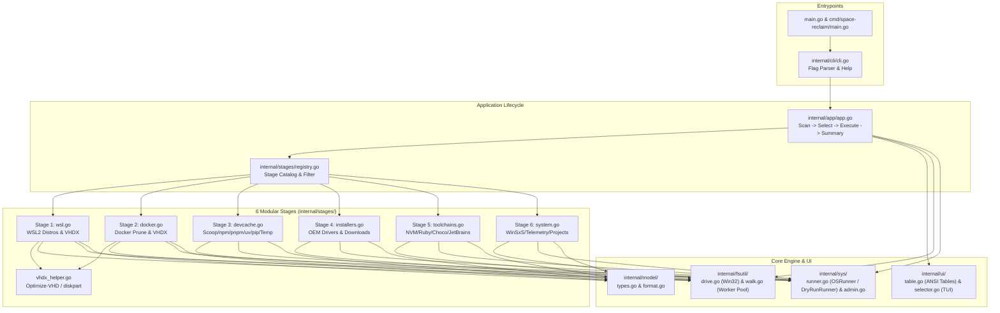
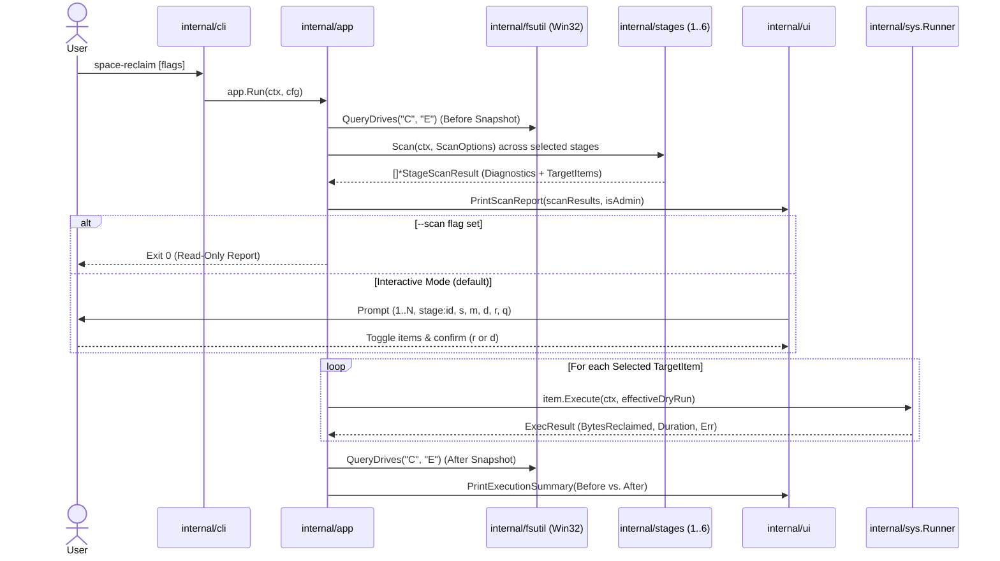

# Architecture & Dataflow Overview

This document explains the internal package architecture, concurrency model, and execution dataflow of **`space-reclaim`**.

---

## 1. High-Level System Architecture

---

## 2. Execution Lifecycle Sequence

---

## 3. Package Responsibilities

| Package | Files | Responsibility |
| :--- | :--- | :--- |
| `internal/model` | [`types.go`](../../internal/model/types.go), [`format.go`](../../internal/model/format.go) | Defines `Stage`, `TargetItem`, `RiskLevel`, `DriveStats`, `DiagnosticInfo`, `ExecResult`, and ANSI/byte formatters. Zero internal imports. |
| `internal/fsutil` | [`drive.go`](../../internal/fsutil/drive.go), [`walk.go`](../../internal/fsutil/walk.go) | Queries `kernel32.dll` `GetDiskFreeSpaceExW`, performs concurrent directory sizing (`MultiPathSize`) skipping Windows reparse points (`0x0400`), and deletes files/folders safely (`RemovePath`). |
| `internal/sys` | [`runner.go`](../../internal/sys/runner.go), [`admin.go`](../../internal/sys/admin.go) | Abstracts `pwsh`, `wsl.exe`, and binary execution behind `Runner` (`OSRunner` and `DryRunRunner`), decodes `wsl.exe` UTF-16LE output, and checks Administrator elevation. |
| `internal/stages` | [`registry.go`](../../internal/stages/registry.go), [`wsl.go`](../../internal/stages/wsl.go), [`docker.go`](../../internal/stages/docker.go), [`devcache.go`](../../internal/stages/devcache.go), [`installers.go`](../../internal/stages/installers.go), [`toolchains.go`](../../internal/stages/toolchains.go), [`system.go`](../../internal/stages/system.go), [`vhdx_helper.go`](../../internal/stages/vhdx_helper.go) | Implements the 6 modular stages and shared VHDX compaction helper. |
| `internal/ui` | [`table.go`](../../internal/ui/table.go), [`selector.go`](../../internal/ui/selector.go) | Renders ANSI progress bars, stage diagnostic tables, selectable item tables, Before/After drive comparisons, and the interactive command loop. |
| `internal/app` | [`app.go`](../../internal/app/app.go) | Coordinates drive snapshots, stage filtering, interactive/automated selection, admin checks, and execution reporting. |
| `internal/cli` | [`cli.go`](../../internal/cli/cli.go) | Parses CLI flags (`--scan`, `--stages`, `--risk`, `--dry-run`, `--yes`, `--min-size`, `--projects-dir`) and handles `SIGINT`/`SIGTERM` cancellation. |
